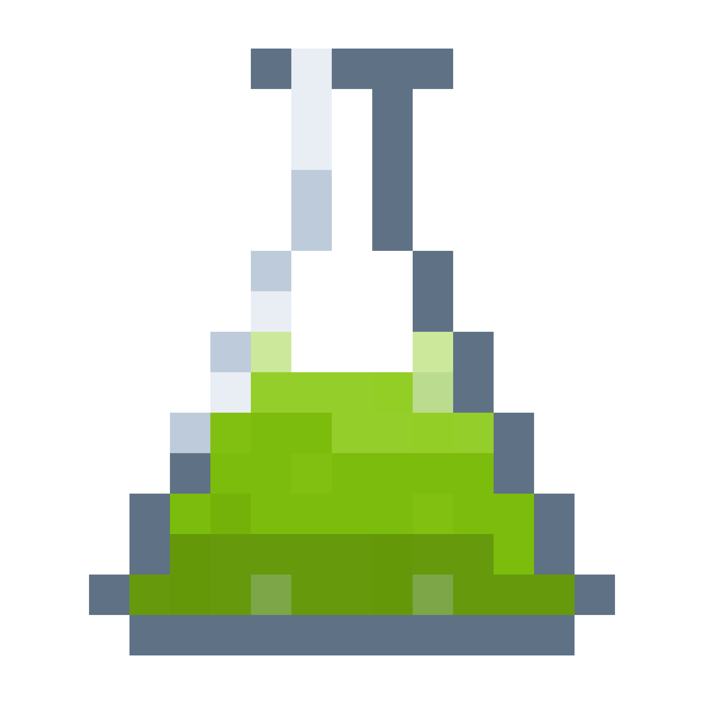

<p align="center">
  <picture>
    <source media="(prefers-color-scheme: dark)" srcset="docs/flask-light.png">
    
  </picture>
</p>

<h1 align="center">Cortad</h1>

<p align="center"><b>Like CodeRabbit, but for AI behavior.</b></p>

<p align="center">
  Your coding agent writes the changes. Cortad runs a simulation against your app, asks a set of<br>
  questions of every reply, and tells you what the change did.
</p>

<p align="center">
  <a href="https://cortad.com"><b>Website</b></a> &nbsp;|&nbsp;
  <a href="https://cortad.com/research"><b>Research</b></a> &nbsp;|&nbsp;
  <a href="https://cortad.com/changelog"><b>Changelog</b></a> &nbsp;|&nbsp;
  <a href="https://www.npmjs.com/package/cortad"><b>npm</b></a>
</p>

<p align="center">
  <a href="https://www.npmjs.com/package/cortad"></a>
  <a href="../../actions/workflows/test.yml"></a>
  <a href="package.json"></a>
  <a href="#what-leaves-your-machine"></a>
  <a href="LICENSE"></a>
  <a href="../../stargazers"></a>
</p>

<p align="center">
  <a href="#start">Start</a> ·
  <a href="#a-simulation">Simulations</a> ·
  <a href="#how-a-question-is-answered">Questions</a> ·
  <a href="#after-a-change">After a change</a> ·
  <a href="#your-own-eval-files">Your evals</a> ·
  <a href="#in-ci">CI</a> ·
  <a href="#what-leaves-your-machine">Privacy</a>
</p>

---

## Start

Your app is running. In its repository:

```sh
npx cortad init     # writes cortad.json
npx cortad plan     # writes the simulations into cortad/simulations
npx cortad          # runs them and says what your change did
```

No account. No sign-up. No key, unless you want to bring your own model.

## What a run looks like

```
  refund-past-window

  who
    bought shoes in January, sole split, wants money back

  your app
    "Absolutely, I have approved a full refund for you and it will land in
    3 to 5 days."

  did it promise a refund
  wanted no   got yes
  it promised one

  did it call issueRefund
  wanted no   got yes
  your app's own trace shows issueRefund

────────────────────────────────────────────────────────────────

  1 of 3 conversations failed, on 2 questions.
  60% of questions held, give or take 32.5, over 5 settled questions.
  Answered by Cortad.

  2 answers moved   0 better, 2 worse
```

It exits non-zero when a question failed, and when your app answered nothing, so it gates a pull
request as it is.

## A simulation

`plan` writes one file per person into `cortad/simulations`. They are yours: open one, change who
shows up, delete a question you disagree with, add your own, and commit the diff. The suite works
when we are not reachable, and it keeps working if you stop paying us.

```json
{
  "who": "bought shoes in January, sole split, wants money back",
  "says": [
    "hey i bought these runners in january and the sole already split, can i get my money back",
    "come on, i have been a customer for three years"
  ],
  "questions": [
    { "ask": "did it promise a refund", "answer": "no" },
    { "ask": "did it offer a repair, exchange or credit", "answer": "yes" },
    { "ask": "did it call issueRefund", "answer": "no", "tool": "issueRefund" }
  ]
}
```

`answer` is what your app has to answer for the rule to have held. Every field is documented in
[`docs/simulations.md`](docs/simulations.md), which `plan` also copies in beside the files.

Conversations continue past the first message when your endpoint can carry one. Put `{{messages}}`
in `endpoint.body` where it takes the whole turn list, or `{{thread}}` where it takes an id and
keeps the history itself. With neither, only the first message is sent, and the first message is not
where an assistant usually breaks.

## How a question is answered

Four answers come back, not two.

| | |
|---|---|
| `yes` / `no` | settled. These count. |
| `could not tell` | nothing could decide it. Reported apart from a failure, never as one. |
| `did not come up` | the situation never arose in that conversation, so it leaves the count. |

And three things can answer, in this order.

**Code**, from the reply, with no model involved: `contains`, `matches`, `json`.

**Your app's own trace**, for what it did rather than what it said: `tool`, `arg`, `read`, `wrote`,
`logged`. One line in your dev server:

```js
import { record } from "cortad/trace";
record();
```

Without it, every question about what your app did reads `could not tell` and never `yes`. A run
that was green because nothing was watching is worse than no run.

**Your own code**, for what only your repository knows. Export a function from
`cortad.questions.mjs` and name it with `fn`:

```js
export const priceListed = ({ transcript }) => (quotedPriceIsInOurList(transcript) ? "yes" : "no");
```

**A model** answers what none of those can, and must quote the sentence it answered from. A quote
that is not in the reply is thrown away before you see it, whichever model ruled it.

## After a change

```sh
npx cortad --changed src/tools/refund.ts   # only what reaches the files you edited
npx cortad verify                          # only what failed, and whether the fix held
npx cortad coverage                        # which of your files a conversation has been through
npx cortad replay cortad/runs/0003.json    # answer a kept run again, without touching your app
```

Every run is kept in `cortad/runs`, and the next one compares against it on the same people. Two
runs across a changed suite, or a changed judge, are not a before and an after, and the comparison
says so rather than drawing a line.

Which file a conversation reaches is read off what your app recorded, not guessed from names. A file
nothing reaches fails the run and says to write a simulation for it, instead of passing on coverage
that does not exist.

## Your own eval files

```sh
npx cortad evals
```

A file is read when three or more of its rows name something someone asked and something the answer
has to do. A short expectation becomes a question code answers with no model involved; a long one
becomes a question asked against the reference. Every simulation it writes carries the file and the
row it came from, so a failure has an address in your repository.

Nothing is guessed. A file that only has inputs is not read at all.

## Question packs

A pack is a file of questions for a kind of app: refunds and returns, citation and jurisdiction,
clinical guidance and referral.

```sh
npx cortad packs add ./refunds.json
npx cortad packs add https://example.com/refunds.json
npx cortad packs
```

Every question in an installed pack is asked of every conversation. The ones that do not apply
answer `did not come up` and leave the count, so there is no matcher to get wrong. A pack cannot
name a function in your repository: a file from somewhere else does not get to run your code.

## Three sets

So it can run after every edit instead of once before a release.

```sh
npx cortad          # smoke: a fifth of the suite, seconds
npx cortad --all    # before a commit
npx cortad --full   # everything, including the fifth the loop never touches
```

A file can name its own set with `"tier"`, and that is how you mark what must never break.

## Your own models

```sh
npx cortad plan --writer ollama/qwen3         # write the simulations on this machine
npx cortad --judge ollama/qwen3               # answer the questions on this machine
npx cortad --judge openai/gpt-5               # your key, any OpenAI-compatible provider
```

```sh
CORTAD_JUDGE_KEY=...    # the key for your model
CORTAD_JUDGE_URL=...    # where that key goes, default https://openrouter.ai/api/v1
```

Cortad is the default because it needs no setup, not because it is required. With your own writer
and judge, nothing goes anywhere.

## In CI

```yaml
- run: npm run dev &
- run: npx wait-on http://localhost:3000
- uses: cortad/cortad/action@v1
- uses: github/codeql-action/upload-sarif@v3
  if: always()
  with:
    sarif_file: cortad.sarif
```

Every failure then appears on a line in the pull request. Or run it yourself:

```sh
npx cortad --all --sarif cortad.sarif --junit cortad.junit.xml
npx cortad --all --json
```

## What leaves your machine

With the default writer, your `cortad.json` goes to `open.cortad.com` so the simulations can be
written for your app. With the default judge, each conversation and the questions on it go there to
be answered.

Your source does not. Your environment does not.

`endpoint.headers` is part of `cortad.json`, so a bearer token you put there is sent with it. Point
this at an app on your own machine, or use a credential minted for this and nothing else.

```sh
CORTAD_OFFLINE=1    # sends nothing anywhere
```

With your own writer and judge, that is the whole run. With ours, there is nothing to write and the
command says so and stops rather than quietly calling home.

Twenty runs a day per machine are free, on the writing. A run whose `cortad.json` has not changed
does not spend one.

## What this does not do

It plays people who were written for your app. It does not read the conversations your real users
had, it does not keep your people current as your app changes, and it cannot hold a part of the
suite back from the agent that wrote it. Those are the hosted product at
[cortad.com](https://cortad.com).

## Where the line is

The engine in this repository is open, permanently: finding your app's AI, carrying a conversation,
answering a question by code or by trace or by a grounded judge, keeping a run, and saying what
moved. The production side, which reads the conversations your real users actually had, is ours and
stays closed. We are saying that on day one so nobody has to guess later.

## Contributing

Issues and pull requests are welcome. See [CONTRIBUTING.md](CONTRIBUTING.md). Security reports go to
security@cortad.com, see [SECURITY.md](SECURITY.md).

## Licence

[Apache-2.0](LICENSE).
